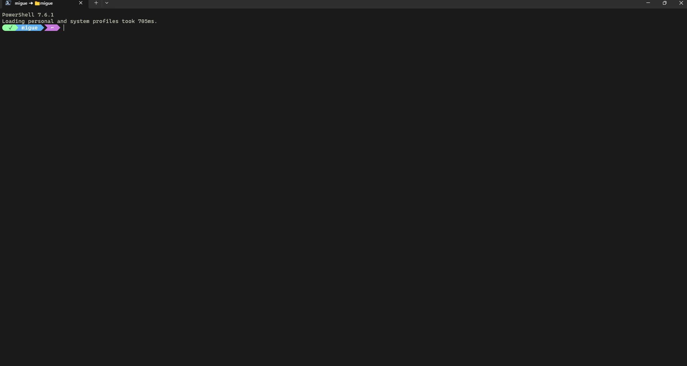
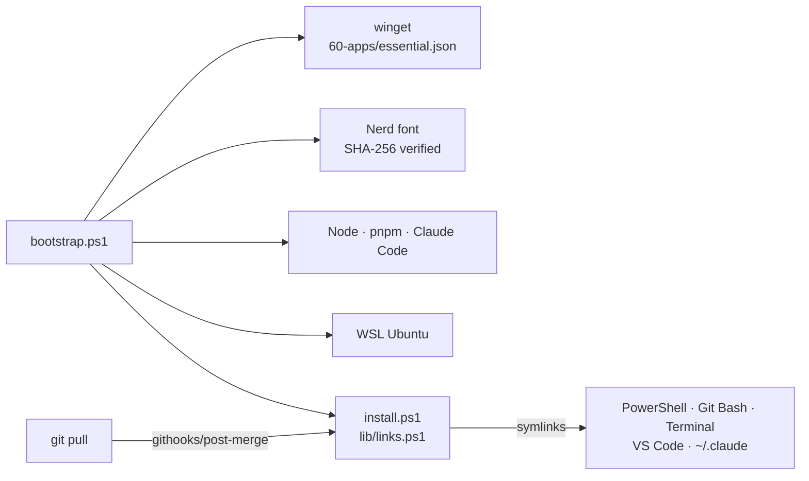

[English](README.md) | **Español**

# dotfiles-windows

Entorno de desarrollo de Windows 11 en un comando: PowerShell 7 con oh-my-posh,
Windows Terminal, VS Code, WSL, el toolchain de desarrollo y una capa global de
Claude Code. Idempotente y con descargas verificadas.

[](https://github.com/M1gu3l4ngel/dotfiles-windows/actions/workflows/ci.yml)
[](LICENSE)



## Qué hay en el repo

Cada carpeta numerada es un área del entorno, con su propio README.

| Carpeta | Contenido |
|---|---|
| `10-shell/` | Perfiles de PowerShell y Git Bash y el tema del prompt (`capr4n`, compartido con Parrot) ([10-shell/README.es.md](10-shell/README.es.md)) |
| `20-terminal/` | Settings de Windows Terminal ([20-terminal/README.es.md](20-terminal/README.es.md)) |
| `30-vscode/` | Settings, keybindings y lista de extensiones de VS Code ([30-vscode/README.es.md](30-vscode/README.es.md)) |
| `40-format/` | Estilo global de Prettier y EditorConfig para proyectos sin el suyo ([40-format/README.es.md](40-format/README.es.md)) |
| `50-claude/` | Capa global de Claude Code: `CLAUDE.md`, hooks, línea de estado, panel de tareas y plantilla de settings ([50-claude/README.es.md](50-claude/README.es.md)) |
| `60-apps/` | Apps del entorno: las esenciales, que instala `bootstrap.ps1`, y las opcionales ([60-apps/README.es.md](60-apps/README.es.md)) |

Y alrededor:

| Ruta | Contenido |
|---|---|
| `bootstrap.ps1` | Instalación del entorno en un comando |
| `install.ps1` | Symlinks de configuración (`-Check` para ver su estado) |
| `uninstall.ps1` | Revertir los symlinks y restaurar los backups (`-DryRun` para simular) |
| `lib/` | Código compartido (el mapeo de symlinks) |
| `githooks/` | `post-merge`: vuelve a correr `install.ps1` tras cada `git pull` |
| `tools/` | Comprobaciones (`check.ps1`, las mismas del CI) y el asistente del nombre del prompt |
| `docs/` | Guías: PC nueva, firma de commits, formato ([docs/README.es.md](docs/README.es.md)) |
| `.claude/rules/` | Convenciones del proyecto (las carga Claude Code) |

## Cómo funciona

`bootstrap.ps1` instala las herramientas; `install.ps1` enlaza cada archivo de
configuración del repo al sitio donde lo lee su programa. Como son enlaces,
editar el repo es editar la configuración en uso, y un `git pull` en otra PC la
aplica allí.



## Reproducir en un comando

Paso a paso desde un Windows recién instalado, con cada ventana y cada reinicio:
[docs/getting-started.es.md](docs/getting-started.es.md). La versión corta, desde
PowerShell como administrador (pedirá UAC para WSL, Docker y algunas apps):

```powershell
git clone https://github.com/M1gu3l4ngel/dotfiles-windows.git $env:USERPROFILE\dotfiles
cd $env:USERPROFILE\dotfiles
.\bootstrap.ps1
```

Para ver qué haría sin cambiar nada: `.\bootstrap.ps1 -DryRun`.

Después, completa los pasos manuales (claves GPG/SSH) que el propio script lista.

## Requisitos previos

- Windows 10/11 con `winget` (App Installer, de la Microsoft Store).
- **git** para clonar el repo. Si la PC no lo trae (recién formateada), instálalo
  primero y reabre la terminal: `winget install Git.Git`. El `bootstrap.ps1`
  instala y actualiza todo lo demás de forma idempotente (git incluido: si ya
  está, lo salta).
- **Modo de desarrollador** activado (Configuración → Sistema → Para
  desarrolladores) o ejecutar PowerShell como administrador: necesario para
  crear los symlinks.
- Scripts locales permitidos: un Windows nuevo los bloquea (política
  `Restricted`). Una vez, desde PowerShell:
  `Set-ExecutionPolicy -Scope CurrentUser RemoteSigned`.
- Recomendado: ejecutar `bootstrap.ps1` como administrador (WSL y Docker lo piden).

## Qué hace bootstrap.ps1

Es idempotente: cada paso comprueba si ya está hecho, así que se puede re-ejecutar
sin romper nada (por ejemplo tras un reinicio).

| Paso | Qué instala o configura |
|---|---|
| 1 | Variables de entorno hacia `D:` (o `C:` si no hay `D:`), `PNPM_HOME` incluido; van primero para que Rust se instale ahí |
| 2 | Apps esenciales de `60-apps/essential.json`: Git, PowerShell 7, Windows Terminal, VS Code, oh-my-posh, Gpg4win, Rust, Python, Docker, nvm-windows y CLI tools (fzf, ripgrep, bat, fd, jq, lsd, Neovim, shfmt) |
| 3 | CaskaydiaCove Nerd Font (descarga verificada por SHA-256) |
| 4 | Node (nvm-windows) + pnpm + Claude Code en `<disk>\Dev\npm-global` |
| 5 | WSL Ubuntu 26.04 (requiere reinicio) |
| 6 | git: nombre, email noreply y defaults |
| 7 | Symlinks de configuración, y el `settings.json` de Claude Code si la máquina no tiene uno (`install.ps1`) |
| 8 | Extensiones de VS Code de `30-vscode/vscode/extensions.txt` (solo las que faltan) |
| 9 | Muestra los pasos manuales que implican secretos (GPG/SSH) |

Solo instala el **entorno**. Las apps personales no se tocan (ver `60-apps/`).

## Instalar solo las configuraciones

Si ya tienes el stack instalado y solo quieres estas configs:

```powershell
.\install.ps1
```

Antes de crear cada enlace, `install.ps1` renombra tu archivo existente con el
sufijo `.pre-dotfiles.bak`. Para volver atrás, usa `uninstall.ps1` (abajo).

Para ver el estado de cada enlace, de los hooks de Claude Code y del hook
`post-merge` sin cambiar nada (sale con 1 si algo no está bien):

```powershell
.\install.ps1 -Check
```

## Desinstalar

Revierte los symlinks y restaura tus archivos originales (los `.pre-dotfiles.bak`).
Con `-DryRun` solo muestra qué haría, sin tocar nada; sin él, revierte de verdad:

```powershell
.\uninstall.ps1 -DryRun
.\uninstall.ps1
```

No desinstala apps ni toca variables de entorno o WSL.

## Pasos manuales (implican secretos, no se automatizan)

1. Claves SSH y GPG, y firma de commits: [docs/gpg-signing.es.md](docs/gpg-signing.es.md).

## Reproducibilidad entre máquinas

El repo detecta el disco de trabajo (`D:` o `C:`) y no depende de rutas fijas de
usuario, así que clonarlo y correr `bootstrap.ps1` deja otra PC con el mismo
entorno. Las apps personales y los secretos se restauran aparte (imagen del
sistema y claves nuevas).

## Mantener otra PC al día

Con una PC ya montada, llevarle un cambio hecho en otra es un `git pull`. En la
PC donde hiciste el cambio, haz commit y push. En la otra:

```powershell
cd $env:USERPROFILE\dotfiles
git pull
```

Las configuraciones son symlinks hacia el repo, así que lo que traes se aplica
al momento (reabre la terminal o VS Code para verlo). Tras cada pull, git
ejecuta además `install.ps1` solo (`githooks/post-merge`, que `install.ps1`
activa la primera vez), y eso cubre el resto:

- Se crean los enlaces nuevos (`lib/links.ps1`).
- Se registran en `~/.claude/settings.json` los hooks nuevos de Claude Code,
  con un backup antes y sin tocar nada más del archivo.
- Si el pull cambió `bootstrap.ps1` o `60-apps/essential.json` (hay
  herramientas nuevas), ejecuta tú
  `.\bootstrap.ps1`: instalar programas no es automático.

Lo que no se versiona no viaja: las claves, `~/.claude/entorno.md` y
`POSH_NAME`. Las extensiones nuevas de VS Code se instalan volviendo a correr `.\bootstrap.ps1`.

## Nombre visual del prompt (opcional)

Por defecto el prompt muestra tu usuario de Windows. Si prefieres mostrar otro
nombre (solo en pantalla, sin tocar el sistema), usa el ayudante:

```powershell
.\tools\set-prompt-name.ps1
```

Te pregunta el nombre (Enter en blanco = tu usuario real) y lo guarda en la
variable `POSH_NAME`, que el tema lee. Es puramente decorativo: no afecta rutas,
comandos ni git.

Para una sola terminal, sin guardarlo (por ejemplo, para una captura), pon la
variable en esa sesión. El prompt y el título de la pestaña cambian en la
siguiente línea, y todo vuelve a la normalidad al cerrarla:

```powershell
$env:POSH_NAME = 'demo-user'
```

En Git Bash: `export POSH_NAME=demo-user`. Para volver a tu usuario en la misma
terminal: `Remove-Item Env:POSH_NAME` (PowerShell) o `unset POSH_NAME`
(Git Bash).

## Solución de problemas

| Síntoma | Causa | Solución |
|---|---|---|
| "la ejecución de scripts está deshabilitada en este sistema" | Política `Restricted` de un Windows nuevo | `Set-ExecutionPolicy -Scope CurrentUser RemoteSigned` |
| `install.ps1` falla al crear symlinks | Developer Mode apagado | Activarlo, o ejecutar como administrador |
| El prompt no aparece en una terminal nueva | El perfil no se cargó | `. $PROFILE`, o reabrir la terminal |
| Iconos como cuadrados | Falta CaskaydiaCove Nerd Font | Re-ejecutar `bootstrap.ps1` |
| `nvm` no reconocido tras el bootstrap | PATH no refrescado | Reabrir PowerShell y volver a correr `bootstrap.ps1` |
| GitHub muestra "Unverified" | El UID de la clave GPG no tiene el email noreply | [docs/gpg-signing.es.md](docs/gpg-signing.es.md) |

## Documentación y contribución

Guías en [docs/](docs/README.es.md), empezando por la de PC nueva:
[docs/getting-started.es.md](docs/getting-started.es.md). Convenciones en `.claude/rules/`. Para
contribuir o modificar el repo: [CONTRIBUTING.es.md](CONTRIBUTING.es.md).

## Créditos y licencia

El prompt de oh-my-posh y la paleta de colores se comparten con
[dotfiles-parrot](https://github.com/M1gu3l4ngel/dotfiles-parrot).

Licencia [MIT](LICENSE).
