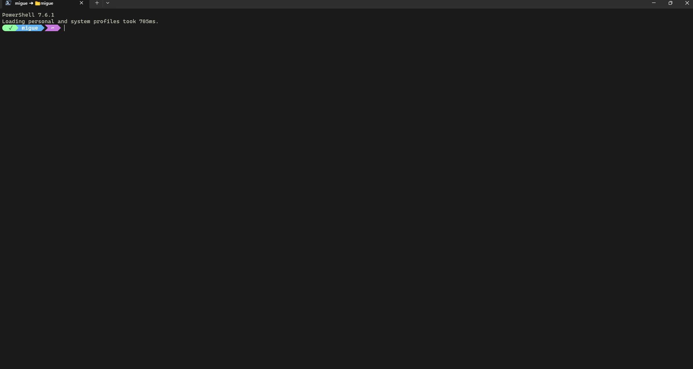
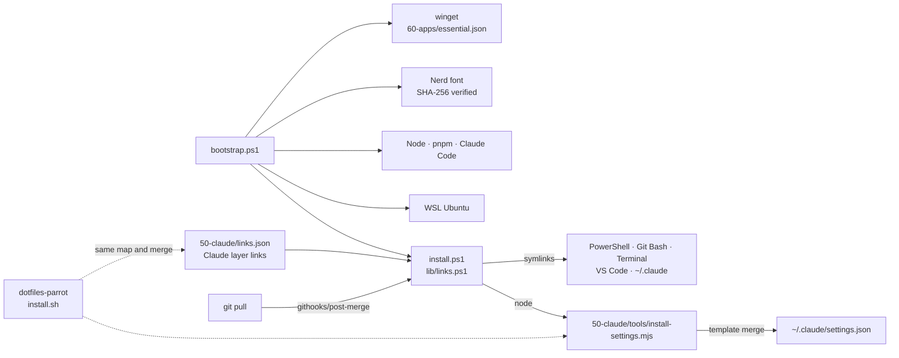

<p align="center">
  <picture>
    <source media="(prefers-color-scheme: dark)" srcset="assets/dotfiles-windows-lockup-white.svg">
    
  </picture>
</p>

<p align="center">
  Windows 11 development environment in one command.<br>
  PowerShell 7 with oh-my-posh, Windows Terminal, VS Code, WSL, the toolchain and a global Claude
  Code layer, idempotent and with verified downloads.
</p>

<p align="center">
  <a href="#structure">Structure</a> ·
  <a href="#how-it-works">How it works</a> ·
  <a href="#getting-started">Getting started</a> ·
  <a href="#usage">Usage</a> ·
  <a href="#documentation">Documentation</a> ·
  <a href="#contributing">Contributing</a> ·
  <a href="#security">Security</a> ·
  <a href="#license">License</a>
</p>

<p align="center">
  <a href="https://github.com/M1gu3l4ngel/dotfiles-windows/actions/workflows/ci.yml"></a>
  
  
  
  <a href="LICENSE"></a>
</p>

---



## Structure

Each numbered folder is one area of the environment, with its own README.

| Folder | Contents |
|---|---|
| `10-shell/` | PowerShell and Git Bash profiles and the prompt theme (`capr4n`, shared with Parrot) ([10-shell/README.md](10-shell/README.md)) |
| `15-git/` | Git identity, signing and the GitHub account each remote uses; private organizations stay in `~/.gitconfig.local` ([15-git/README.md](15-git/README.md)) |
| `20-terminal/` | Windows Terminal settings ([20-terminal/README.md](20-terminal/README.md)) |
| `30-vscode/` | VS Code settings, keybindings and extension list ([30-vscode/README.md](30-vscode/README.md)) |
| `40-format/` | Global Prettier and EditorConfig style for projects without their own ([40-format/README.md](40-format/README.md)) |
| `50-claude/` | Global Claude Code layer: `CLAUDE.md`, hooks, status line, task panel and settings template ([50-claude/README.md](50-claude/README.md)) |
| `60-apps/` | Environment apps: the essential ones, which `bootstrap.ps1` installs, and the optional ones ([60-apps/README.md](60-apps/README.md)) |

And around them:

| Path | Contents |
|---|---|
| `bootstrap.ps1` | One-command environment install |
| `install.ps1` | Configuration symlinks (`-Check` to see their state) |
| `uninstall.ps1` | Revert the symlinks and restore the backups (`-DryRun` to simulate) |
| `lib/` | Shared code (the symlink mapping) |
| `githooks/` | `post-merge`: re-runs `install.ps1` after each `git pull` |
| `tools/` | Checks (`check.ps1`, the same as CI) and the prompt name helper |
| `docs/` | Guides: new PC, commit signing, formatting ([docs/README.md](docs/README.md)) |
| `.github/` | CI, Dependabot, and the issue and pull request templates |
| `.claude/rules/` | Project conventions (loaded by Claude Code) |

## How it works

`bootstrap.ps1` installs the tools; `install.ps1` links each configuration file
from the repo to where its program reads it. Since they are links, editing the
repo is editing the live configuration, and a `git pull` on another PC applies
it there.



## Getting started

Step by step from a freshly installed Windows, with each window and reboot:
[docs/getting-started.md](docs/getting-started.md). The short version follows.

### Prerequisites

- Windows 10/11 with `winget` (App Installer, from the Microsoft Store).
- **git** to clone the repo. If the PC doesn't have it (freshly formatted), install
  it first and reopen the terminal: `winget install Git.Git`. `bootstrap.ps1`
  installs and updates everything else idempotently (git included: if it's already
  there, it skips it).
- **Developer Mode** enabled (Settings → System → For developers) or
  run PowerShell as administrator: required to create the symlinks.
- Local scripts allowed: a new Windows blocks them (`Restricted` policy). Once,
  from PowerShell: `Set-ExecutionPolicy -Scope CurrentUser RemoteSigned`.
- Recommended: run `bootstrap.ps1` as administrator (WSL and Docker require it).

### Install in one command

From PowerShell as administrator (it will prompt for UAC for WSL, Docker and some apps):

```powershell
git clone https://github.com/M1gu3l4ngel/dotfiles-windows.git $env:USERPROFILE\dotfiles
cd $env:USERPROFILE\dotfiles
.\bootstrap.ps1
```

To preview what it would do without changing anything: `.\bootstrap.ps1 -DryRun`.

Afterwards, complete the manual steps (GPG/SSH keys) that the script itself lists.

### What bootstrap.ps1 does

It is idempotent: each step checks whether it is already done, so it can be re-run
without breaking anything (for example after a reboot).

| Step | What it installs or configures |
|---|---|
| 1 | Environment variables pointing to `D:` (or `C:` if there is no `D:`), including `PNPM_HOME`; they go first so Rust installs there |
| 2 | Essential apps from `60-apps/essential.json`: Git, PowerShell 7, Windows Terminal, VS Code, oh-my-posh, Gpg4win, Rust, Python, Docker, fnm and CLI tools (fzf, ripgrep, bat, fd, jq, lsd, Neovim, shfmt) |
| 3 | CaskaydiaCove Nerd Font (download verified by SHA-256) |
| 4 | Node with fnm (versions in `<disk>\Dev\fnm`; each terminal switches to the repo's version on entering it) + pnpm + Claude Code in `<disk>\Dev\npm-global` |
| 5 | WSL Ubuntu 26.04 (requires a reboot) |
| 6 | git identity in `~/.gitconfig.local`, if the machine has none: `-GitName` and `-GitEmail`, the owner's by default |
| 7 | Configuration symlinks, and the Claude Code `settings.json` if the machine has none (`install.ps1`) |
| 8 | VS Code extensions from `30-vscode/vscode/extensions.txt` (only the missing ones) |
| 9 | Shows the manual steps that involve secrets (GPG/SSH) |

It only installs the **environment**. Personal apps are left untouched (see `60-apps/`).

### Install only the configurations

If you already have the stack installed and only want these configs:

```powershell
.\install.ps1
```

Before creating each link, `install.ps1` renames your existing file with the
`.pre-dotfiles.bak` suffix. To roll back, use `uninstall.ps1` (below).

To see the state of each link, the Claude Code hooks and the `post-merge` hook
without changing anything (it exits with 1 if something is wrong):

```powershell
.\install.ps1 -Check
```

### Manual steps (involve secrets, not automated)

1. SSH and GPG keys, and commit signing: [docs/gpg-signing.md](docs/gpg-signing.md).

### Reproducibility across machines

The repo detects the work disk (`D:` or `C:`) and does not depend on fixed user
paths, so cloning it and running `bootstrap.ps1` leaves another PC with the same
environment. Personal apps and secrets are restored separately (system image and
new keys).

## Usage

### Keeping another PC up to date

Once a PC is set up, bringing it a change made on another one is a `git pull`.
On the PC where you made the change, commit and push. On the other one:

```powershell
cd $env:USERPROFILE\dotfiles
git pull
```

The configurations are symlinks into the repo, so what you pull applies right
away (reopen the terminal or VS Code to see it). After each pull git also runs
`install.ps1` on its own (`githooks/post-merge`, which `install.ps1` turns on the
first time), and that covers the rest:

- New links (`lib/links.ps1`) are created.
- New Claude Code hooks are registered in `~/.claude/settings.json`, with a
  backup first and without touching anything else in the file.
- If the pull changed `bootstrap.ps1` or `60-apps/essential.json` (there are
  new tools), run
  `.\bootstrap.ps1` yourself: installing programs is not automatic.

What is not versioned does not travel: keys, `~/.claude/entorno.md` and
`POSH_NAME`. New VS Code extensions are installed by running `.\bootstrap.ps1` again.

### Visual prompt name (optional)

By default the prompt shows your Windows username. If you prefer to show a different
name (on screen only, without touching the system), use the helper:

```powershell
.\tools\set-prompt-name.ps1
```

It asks for the name (blank Enter = your real username) and saves it in the
`POSH_NAME` variable, which the theme reads. It is purely decorative: it does not
affect paths, commands or git.

For a single terminal, without saving it (for example, for a screenshot), set
the variable in that session. The prompt and the tab title change on the next
line, and everything reverts when you close it:

```powershell
$env:POSH_NAME = 'demo-user'
```

In Git Bash: `export POSH_NAME=demo-user`. To go back to your username in the
same terminal: `Remove-Item Env:POSH_NAME` (PowerShell) or `unset POSH_NAME`
(Git Bash).

### Uninstall

Reverts the symlinks and restores your original files (the `.pre-dotfiles.bak`
ones). With `-DryRun` it only shows what it would do, without touching anything;
without it, it reverts for real:

```powershell
.\uninstall.ps1 -DryRun
.\uninstall.ps1
```

It does not uninstall apps or touch environment variables or WSL.

## Troubleshooting

| Symptom | Cause | Fix |
|---|---|---|
| "running scripts is disabled on this system" | `Restricted` policy on a new Windows | `Set-ExecutionPolicy -Scope CurrentUser RemoteSigned` |
| `install.ps1` fails to create symlinks | Developer Mode off | Enable it, or run as administrator |
| The prompt does not appear in a new terminal | The profile did not load | `. $PROFILE`, or reopen the terminal |
| Icons show as squares | Missing CaskaydiaCove Nerd Font | Re-run `bootstrap.ps1` |
| `fnm` not recognized after bootstrap | PATH not refreshed | Reopen PowerShell and run `bootstrap.ps1` again |
| `Can't find an installed Node version matching …` on entering a folder | The repo asks for a Node version you do not have | Answer `y` and fnm installs it; `N` keeps the current one |
| GitHub shows "Unverified" | The GPG key UID does not have the noreply email | [docs/gpg-signing.md](docs/gpg-signing.md) |

## Documentation

Guides in [docs/](docs/README.md), starting with the new PC one:
[docs/getting-started.md](docs/getting-started.md). Conventions in `.claude/rules/`.

## Contributing

Changes are welcome: the flow, the checks and the commit format are in
[CONTRIBUTING.md](CONTRIBUTING.md), and everyone who takes part follows the
[code of conduct](CODE_OF_CONDUCT.md).

## Security

A vulnerability is reported privately, never in a public issue:
[SECURITY.md](SECURITY.md).

## License

[MIT](LICENSE). The oh-my-posh prompt and the color palette are shared with
[dotfiles-parrot](https://github.com/M1gu3l4ngel/dotfiles-parrot).
