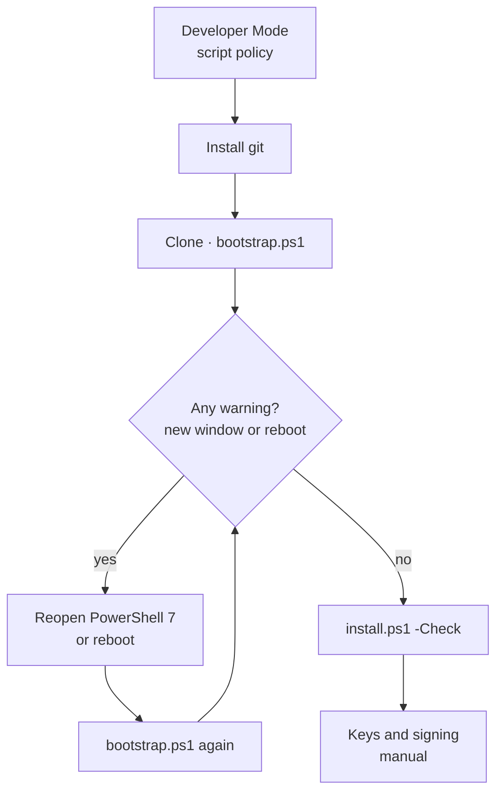

[English](getting-started.md) | **Español**

# Una PC nueva desde cero

De un Windows 11 recién instalado al entorno completo. Cada paso dice en qué
shell se ejecuta y si necesita administrador. Lleva cerca de una hora, casi toda
de descargas, y un reinicio por WSL.



## 1. Antes de empezar

- Windows 11 con sesión iniciada y conexión a internet.
- `winget` disponible: viene con App Installer de la Microsoft Store. Si
  `winget --version` falla en PowerShell, actualiza App Installer desde la Store.
- Si hiciste un fork del repo: en el paso 5, pasa a `bootstrap.ps1` tu nombre
  de git y tu correo noreply de GitHub con `-GitName` y `-GitEmail`. Sin ellos usa
  los del dueño. Van a `~/.gitconfig.local`, fuera del repo.

## 2. Activar el modo de desarrollador

Configuración → Sistema → Para desarrolladores → **Modo de desarrollador**. Sin
él, crear los symlinks de configuración necesita administrador.

## 3. Permitir los scripts locales

Abre **Windows PowerShell como administrador** (Inicio → escribe `PowerShell` →
Ejecutar como administrador). En una PC nueva Windows no ejecuta scripts
(política `Restricted`), así que no cargarían ni `bootstrap.ps1` ni el perfil
de PowerShell. Permítelos solo para tu usuario:

```powershell
Set-ExecutionPolicy -Scope CurrentUser RemoteSigned
```

Pide confirmación: responde `S`.

## 4. Instalar git

En la misma ventana:

```powershell
winget install --id Git.Git -e --source winget
```

Cierra la ventana y abre otra **Windows PowerShell como administrador** para que
`git` esté en el PATH.

## 5. Clonar y ejecutar el instalador

```powershell
git clone https://github.com/M1gu3l4ngel/dotfiles-windows.git $env:USERPROFILE\dotfiles
cd $env:USERPROFILE\dotfiles
.\bootstrap.ps1 -DryRun
.\bootstrap.ps1
```

`-DryRun` muestra qué haría sin cambiar nada; el segundo comando instala de
verdad. La tabla de pasos está en el [README](../README.es.md#qué-hace-bootstrapps1).

## 6. Repetirlo hasta que quede completo

Algunas herramientas solo entran en el PATH en una ventana nueva, y WSL necesita
reiniciar. Cuando el script lo diga, cierra la ventana (o reinicia), abre
**PowerShell 7 como administrador** desde Windows Terminal y vuelve a
ejecutarlo. Es idempotente: lo que ya está hecho se salta.

```powershell
cd $env:USERPROFILE\dotfiles
.\bootstrap.ps1
```

Está completo cuando termina sin avisos. Comprueba los enlaces, los hooks de
Claude Code y `post-merge`:

```powershell
.\install.ps1 -Check
```

## 7. Claves y firma (manual)

Las claves SSH y GPG son secretos y no se automatizan. Sigue
[gpg-signing.es.md](gpg-signing.es.md) para crearlas, subirlas a GitHub y
firmar los commits.

Las organizaciones de GitHub con las que trabajas (tuyas, de clientes, del
trabajo) van en `~/.gitconfig.local`, también a mano, para que git elija la cuenta
de cada remoto sin preguntar: ver [15-git/README.es.md](../15-git/README.es.md#lo-que-se-queda-en-la-máquina).

## 8. Opcional

- Las demás herramientas de desarrollo, todas de golpe (o elige en
  [60-apps/README.es.md](../60-apps/README.es.md)):

  ```powershell
  winget import 60-apps\optional.json --accept-package-agreements --accept-source-agreements
  ```

- Claude Code: crea `~/.claude/entorno.md` con el detalle de esta máquina,
  copiando las secciones de `50-claude/entorno.template.md`.
- Nombre del prompt: `.\tools\set-prompt-name.ps1` (ver el
  [README](../README.es.md#nombre-visual-del-prompt-opcional)).

## 9. Listo

Abre Windows Terminal: PowerShell 7 con el prompt, la fuente Nerd y el tema
Monokai. A partir de aquí, los cambios de otra PC llegan con `git pull`
([Mantener otra PC al día](../README.es.md#mantener-otra-pc-al-día)).
