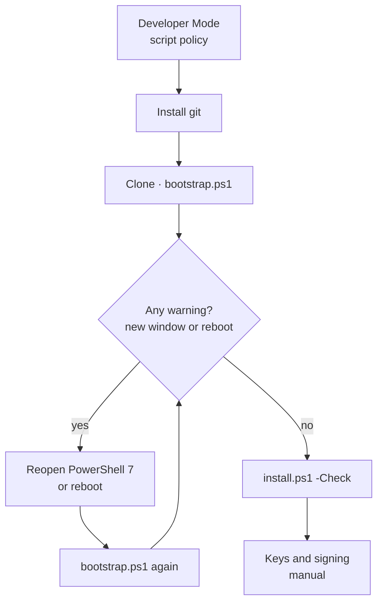

**English** | [Español](getting-started.es.md)

# A new PC from scratch

From a freshly installed Windows 11 to the full environment. Each step says which
shell it runs in and whether it needs administrator rights. It takes about an
hour, most of it downloads, and one reboot for WSL.



## 1. Before you start

- Windows 11 signed in, with internet access.
- `winget` available: it comes with App Installer from the Microsoft Store. If
  `winget --version` fails in PowerShell, update App Installer from the Store.
- If you forked the repo: `bootstrap.ps1` sets the owner's git name and noreply
  email (function `Invoke-Step6Git`). Change them to yours before step 5.

## 2. Turn on Developer Mode

Settings → System → For developers → **Developer Mode**. Without it, creating
the configuration symlinks needs administrator rights.

## 3. Allow local scripts

Open **Windows PowerShell as administrator** (Start → type `PowerShell` → Run
as administrator). On a new PC Windows does not run scripts (`Restricted`
policy), so neither `bootstrap.ps1` nor the PowerShell profile would load.
Allow them for your user only:

```powershell
Set-ExecutionPolicy -Scope CurrentUser RemoteSigned
```

It asks for confirmation: answer `Y`.

## 4. Install git

In the same window:

```powershell
winget install --id Git.Git -e --source winget
```

Close the window and open a new **Windows PowerShell as administrator** so that
`git` is on the PATH.

## 5. Clone and run the installer

```powershell
git clone https://github.com/M1gu3l4ngel/dotfiles-windows.git $env:USERPROFILE\dotfiles
cd $env:USERPROFILE\dotfiles
.\bootstrap.ps1 -DryRun
.\bootstrap.ps1
```

`-DryRun` shows what it would do without changing anything; the second command
installs for real. The table of steps is in the [README](../README.md#what-bootstrapps1-does).

## 6. Run it again until it is complete

Some tools land on the PATH only in a new window, and WSL needs a reboot. When
the script says so, close the window (or reboot), open **PowerShell 7 as
administrator** from Windows Terminal and run it again. It is idempotent: what
is done is skipped.

```powershell
cd $env:USERPROFILE\dotfiles
.\bootstrap.ps1
```

It is complete when the run ends without warnings. Check the links, the Claude
Code hooks and `post-merge`:

```powershell
.\install.ps1 -Check
```

## 7. Keys and signing (manual)

SSH and GPG keys are secrets and are not automated. Follow
[gpg-signing.md](gpg-signing.md) to create them, upload them to GitHub and sign
commits.

The GitHub organizations you work with (your own, clients, work) go in
`~/.gitconfig.local`, also by hand, so git picks the right account for each remote
without asking: see [15-git/README.md](../15-git/README.md#what-stays-on-the-machine).

## 8. Optional

- Other development tools, all at once (or pick from
  [60-apps/README.md](../60-apps/README.md)):

  ```powershell
  winget import 60-apps\optional.json --accept-package-agreements --accept-source-agreements
  ```

- Claude Code: create `~/.claude/entorno.md` with this machine's details, copying
  the sections of `50-claude/entorno.template.md`.
- Prompt name: `.\tools\set-prompt-name.ps1` (see the
  [README](../README.md#visual-prompt-name-optional)).

## 9. Done

Open Windows Terminal: PowerShell 7 with the prompt, the Nerd font and the
Monokai theme. From now on, changes from another PC arrive with `git pull`
([Keeping another PC up to date](../README.md#keeping-another-pc-up-to-date)).
